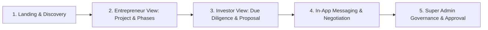

# JANIC 2026: STUDENT PROJECT PRE-EVALUATION DOSSIER & COMPREHENSIVE GUIDE
**Jazeera University | Faculty of Computer Science and Information Technology**
**Project:** MaalHub — Empowering Innovation & Capital

---

## 1. Student Team and Project Information

| Field | Project Details |
| :--- | :--- |
| **Project Title** | **MaalHub** (Empowering Innovation & Capital / Connecting Ideas With Opportunities) |
| **Project / Group Number** | *[Insert Your Assigned Group Number, e.g., Group #12]* |
| **Team Members** | **1. Abdinajiib Artan Osman** (Full-Stack Architecture, Backend APIs, Supabase Auth/DB & Deployment) **2. Sumaya Anwar Mumin** (Frontend Engineering, UI/UX Design, Client State & Pitch Lead) |
| **Faculty / Department** | Faculty of Computer Science and Information Technology (CS & IT) |
| **University** | **Jazeera University** |
| **Supervisor** | *[Insert Supervisor's Name, e.g., Eng. / Dr. Supervisor Name]* |
| **Project Type** | ☑ **Software / Web / Mobile** (Full-Stack Web Application) |
| **Committee Evaluation Date** | *[Insert Evaluation Date, e.g., October 2026]* |

---

## 2. What Every Team Must Be Ready to Explain (The 10 Core Questions)

### Q1. What problem or need does your project address, and who experiences it?
* **The Problem:** In our local and regional economy, early-stage entrepreneurs, innovators, and university graduates face severe barriers when trying to access seed capital and business partners. Traditional financing institutions (banks) require heavy physical collateral, lengthy credit histories, and strict guarantees that young founders do not have. Conversely, local investors, business angels, and diaspora members have capital but lack a trusted, transparent, and structured way to discover vetted, viable startups and monitor how their capital will be used.
* **Who Experiences It:**
  1. **Aspiring Entrepreneurs & Innovators** who have viable business models but lack funding and network access.
  2. **Local and Diaspora Investors** who want to invest in high-potential domestic businesses (in agriculture, education, retail, tech, and tourism) but lack due diligence, structured milestones, and direct communication channels.

### Q2. Who are the target users or beneficiaries?
1. **Entrepreneurs / Founders:** Startup founders, small business owners, and university innovators looking for seed funding, strategic mentorship, and investment partners.
2. **Investors & Business Angels:** Individual investors, syndicate groups, diaspora investors, and venture scouts seeking categorized, transparent, and milestone-tracked investment opportunities.
3. **Platform Administrators / Moderation Committee:** Oversight managers who verify user profiles, review project submissions, ensure ethical guidelines, and maintain platform trust.
4. **The Broader Community & Economy:** Local industries benefit through job creation, digital business formalization, and entrepreneurial growth in vital sectors.

### Q3. What have you developed, designed, researched, or produced?
* **A Full-Stack Web Application:** Built from the ground up featuring three distinct user roles (Entrepreneur, Investor, Super Admin).
* **Role-Specific Interactive Dashboards:**
  - *Entrepreneur Portal:* Venture profile builder, milestone/funding phase manager, financial target tracker, pitch deck document uploader, and proposal inbox.
  - *Investor Portal:* Industry and stage filters, deep-dive project evaluation view, proposal submission system, bookmarking, and portfolio tracker.
  - *Admin Control Center:* Platform-wide moderation, user authorization, project approval/pausing/closing, and transaction analytics.
* **Milestone-Based Investment Tranche Engine:** A structured funding phase model (`project_investment_phases`) where entrepreneurs divide their funding goal into verifiable phases (with milestone titles, targets, and proof-of-work evidence uploads) rather than asking for unverified lump sums.
* **Direct Deal Proposal & In-App Real-Time Messaging System:** End-to-end communication and negotiation loop between investors and founders with formal status tracking (`Pending`, `Accepted`, `Rejected`, `Withdrawn`).

### Q4. What are the project's objectives and main features?
* **Core Objectives:**
  1. Democratize access to startup capital by removing informal gatekeepers.
  2. Increase investment transparency through phased, milestone-based funding.
  3. Provide an intuitive digital meeting ground for entrepreneurs and investors.
* **Key Features:**
  - **Secure Role-Based Authentication:** Dedicated onboarding for entrepreneurs and investors with profile verification.
  - **Comprehensive Project Profiles:** Problem/solution statements, revenue models, competitive advantages, business model breakdown, funding goals, and downloadable documentation.
  - **Categorized Discovery:** Tailored search and filtering across key economic sectors (**Agriculture, Business, Hospitality & Tourism, Education**).
  - **Tranche/Phase Investment System:** Multi-phase funding targets where funds can be linked to measurable development milestones.
  - **Direct Negotiation & Messaging:** Private real-time messaging channel tied to investment inquiries.
  - **Super Admin Moderation:** Verification pipeline to safeguard investors from fraud and maintain high-quality listings.

### Q5. How does the project work? Explain its process, design, or technical approach.
* **System Architecture:** MaalHub is designed as a modern decoupled client-server architecture:
  - **Frontend:** Built with **React 18/19** and **Vite** for high-speed rendering, utilizing **Tailwind CSS** for an ergonomic, responsive design system, and **Lucide React** for visual clarity. Client-side routing is handled with **React Router v6**.
  - **Backend API:** Built with **Node.js** and **Express 5**, implementing RESTful endpoints, **Helmet** for security headers, **CORS** management, **Morgan** request logging, and **express-rate-limit** for DDoS/spam mitigation. Input validation is strictly enforced using **Zod**.
  - **Database & Cloud Storage:** Powered by **Supabase (PostgreSQL)**. Utilizes **Row Level Security (RLS)** policies to ensure multi-tenant data isolation directly at the database engine level. Supabase Storage handles secure file buckets (`profile-photos`, `project-images`, `project-documents`).
* **The Core User Flow:**
  1. *Entrepreneur* registers -> completes startup profile -> creates project with funding tranches and pitch documents -> submits for publication.
  2. *Investor* browses verified ventures by industry/stage -> examines project metrics, problem/solution, and financial phases -> submits a tailored investment proposal with a target dollar amount and message.
  3. *Founder* receives proposal notification -> initiates direct in-app messaging -> reviews terms -> accepts or negotiates proposal.
  4. *Super Admin* oversees ecosystem compliance, platform activity, and user integrity.

### Q6. What is complete, in progress, or still planned?
* **Completed (100% Ready & Demonstrated):**
  - Full Authentication & Role Management (Entrepreneur, Investor, Super Admin).
  - Complete CRUD for Projects (Create, Read, Update, Delete, Pause, Close).
  - Multi-tier Investment Tranches / Phases with evidence submission status.
  - Project Discovery with industry filtering, search, and pagination.
  - Formal Investment Requests system (Send, Accept, Reject, Withdraw).
  - In-App Real-Time Messaging & Conversation Participants model.
  - Bookmarked / Saved Projects functionality.
  - Admin Dashboard with metrics, user management, and project moderation.
  - Responsive UI for desktop, tablet, and mobile browsers.
* **In Progress / Polish:**
  - Enhanced automated email notifications via Nodemailer for real-time deal alerts.
  - Rich document viewer preview for pitch decks inside the browser.
* **Planned (Future Roadmap):**
  - Mobile Application (React Native) for instant push notifications.
  - Direct integration with Somali mobile money gateways (EVC Plus, Premier Wallet, Dahabshiil/e-Dahab) and escrow smart contracts.
  - AI-powered startup valuation estimator and investor-matching recommendation engine.

### Q7. What practical benefit could it provide to the community, university, business, or industry?
* **To Jazeera University & Students:** Acts as a commercialization launchpad for university research, capstone innovations, and student-founded startups, transforming graduation projects from academic shelf-ware into funded commercial businesses.
* **To the Business Community:** Connects local capital directly with productive domestic ventures, reducing reliance on risky informal channels and funding sectors critical to regional development (AgriTech, EdTech, Commerce).
* **To the Economy:** Accelerates youth employment, stimulates entrepreneurial confidence, and fosters formalized financial accountability.

### Q8. What is useful, creative, different, or improved about your solution?
1. **Milestone-Based Investment Tranches (Differentiation):** Unlike traditional crowdfunding sites (Kickstarter/GoFundMe) where all funds are released upfront with zero accountability, MaalHub introduces milestone tranches. Investors commit capital against specific progress gates and verifiable deliverables.
2. **Localized Economic Focus:** Tailored for developing ecosystems where formal venture capital is scarce, focusing on real-economy sectors (Agriculture, Education, Local Commerce) rather than exclusively Western-style software ventures.
3. **Integrated Direct Negotiation Channel:** Combines pitch showcase, formal term proposals, and instant communication under a single authenticated interface.
4. **Enterprise-Grade Security:** Employs PostgreSQL Row Level Security (RLS), Zod request schemas, and token authorization rather than unprotected client-only storage.

### Q9. What challenges did you face, and how did you address them?
* **Challenge 1: Role-Based Authorization & Multi-Tenancy:** Ensuring entrepreneurs, investors, and administrators only access permissible data and routes.
  - *Solution:* Implemented dual-layer protection: client-side route guards (`ProtectedRoute.jsx` with `allowedRole`) coupled with database-level PostgreSQL Row Level Security (RLS) policies.
* **Challenge 2: Multi-Step Milestone & Financial Data Integrity:** Managing complex project data involving multi-phase funding targets, image uploads, and document attachments.
  - *Solution:* Designed normalized relational tables (`projects`, `project_investment_phases`, `project_documents`) with foreign key constraints, cascading deletions, and Zod backend schema validation.
* **Challenge 3: Real-Time Communication & Status Sync:** Synchronizing investment request states and conversations between parties.
  - *Solution:* Built a dedicated messaging relational architecture (`conversations`, `conversation_participants`, `messages`) optimized with indexed lookups and unread indicators.

### Q10. What are the next steps for improvement or further development?
1. **Automated Escrow & Mobile Money Integration:** Implementing escrow smart holding so funds are automatically released upon verified milestone completion.
2. **Investor Syndication:** Allowing multiple smaller investors to co-invest in a single startup tranche.
3. **Incubator & University Hub Integration:** Adding an institutional tier allowing universities and incubators to run cohort-based venture showcases.

---

## 3. Required Preparation Checklist

### A. Project Demonstration Preparation
- [x] **Working System Verified:** Both frontend (`client`) and backend (`server`) running smoothly via monorepo scripts (`npm run dev`).
- [x] **Environment Tested:** Valid environment variables configured (`.env` with Supabase URL, Anon Key, Service Role Key, Port 5000).
- [x] **Device & Hardware Readiness:**
  - Laptop fully charged + power cable.
  - Backup phone hotspot prepared in case university Wi-Fi is slow or unstable.
  - Second device (tablet or phone) ready to demonstrate responsiveness and multi-user live messaging.
- [x] **Backup Assets Ready:**
  - High-resolution screenshots of all major workflows stored locally in `/screenshots` folder.
  - Pre-recorded 60-second screen capture walkthrough in case offline fallback is needed.
- [x] **Demo Accounts & Clean Seed Data:** Pre-configured test accounts ready for instant login:
  - **Entrepreneur Demo:** `entrepreneur@maalhub.com` / `Password123!`
  - **Investor Demo:** `investor@maalhub.com` / `Password123!`
  - **Super Admin Demo:** `admin@maalhub.com` / `Password123!`

---

### B. Core User Journey Demonstration Script (The Live Demo Route)
When demonstrating to the JANIC Committee, follow this exact 5-step journey:

1. **Step 1: Public Discovery (30 seconds)**
   - Open homepage (`/`): highlight clean modern hero, value proposition, and the 4 primary sectors (**Agriculture, Business, Hospitality & Tourism, Education**).
   - Filter projects on `/projects` by industry (e.g., Agriculture) to show responsive querying.
2. **Step 2: Entrepreneur Flow (45 seconds)**
   - Log in as Entrepreneur.
   - Show Entrepreneur Dashboard: overview cards, active ventures, milestone progress.
   - Click into project edit/view: show how funding goals are split into structured **Investment Phases** with evidence upload.
3. **Step 3: Investor Flow (45 seconds)**
   - In a second browser window (incognito), log in as Investor.
   - Open the project detail page: show executive summary, revenue model, problem/solution, and investment phases.
   - Click **"Send Investment Request"**: submit an offer of **$10,000** for Phase 1 with a strategic partnership note.
4. **Step 4: Negotiation & Messaging (30 seconds)**
   - Switch back to Entrepreneur window: show the new investment request appearing in `/entrepreneur/requests`.
   - Click "Message Investor": demonstrate instantaneous messaging between the two parties.
5. **Step 5: Admin Control (20 seconds)**
   - Show `/admin/dashboard`: show platform analytics, user moderation, and status controls (Approve / Pause / Close).

---

### C. Team Member Roles & Speaking Division

| Member | Primary Responsibilities | Presentation Role |
| :--- | :--- | :--- |
| **Abdinajiib Artan Osman** | Full-Stack Architecture, Backend APIs, Supabase Database & Security (RLS), Server Deployment | **Technical Lead & Live Demonstrator:** • Introduces system architecture & technology choices • Operates the live demo interface • Answers database, security, and backend scalability questions |
| **Sumaya Anwar Mumin** | Frontend Engineering, UI/UX Design System, Client State, User Experience | **Pitch Lead & Product Specialist:** • Delivers the opening Problem & Market Need pitch • Explains the user journey, UX decisions, and milestone value • Summarizes societal impact, next steps, and concludes the pitch |

---

## 4. Suggested Project Pitch Structure (2.5 - 3 Minutes Word-for-Word Script)

> **Time Target:** 2 minutes 30 seconds  
> **Rule:** Speak with confidence, clear pacing, and professional posture.

### [0:00 - 0:30] — 1. The Problem (Speaker: Sumaya)
> *"Honorable members of the JANIC Evaluation Committee, good morning. In our country, thousands of brilliant young entrepreneurs and university graduates produce innovative business ideas every year. Yet, over 80% never launch. Why? Because traditional banks demand collateral that young founders simply do not have, and finding an angel investor relies on luck and informal connections. At the same time, willing investors have capital, but lack a trusted platform to discover vetted projects or ensure their money will be used responsibly. There is a broken bridge between capital and innovation."*

### [0:30 - 1:00] — 2. The Solution & Users (Speaker: Sumaya)
> *"To solve this, we created **MaalHub** — a next-generation web platform built to connect visionary entrepreneurs with verified investors. MaalHub serves three key stakeholders: ambitious founders seeking seed capital, investors looking for vetted opportunities across key sectors like Agriculture, Education, and Commerce, and university incubators fostering commercialization."*

### [1:00 - 1:55] — 3. Live Demonstration & Innovation (Speaker: Abdinajiib)
> *"Allow me to show you MaalHub in action. Here on our portal, entrepreneurs can build comprehensive project profiles detailing their business model, revenue strategy, and documentation. But our biggest innovation is **Milestone-Based Investment Tranches**. Rather than asking for a blind lump sum, founders break their target into verified phases.
> 
> As you can see, when an investor browses this Agriculture startup, they don’t just read a pitch; they see Phase 1 equipment acquisition, Phase 2 cultivation, and Phase 3 distribution. The investor can submit a formal investment proposal directly against a specific tranche, and both parties immediately enter a secure, in-app messaging channel to negotiate terms.
> 
> Technically, MaalHub is built with React, Vite, and Tailwind CSS on the frontend, Node.js and Express on the backend, and powered by Supabase PostgreSQL with strict Row Level Security policies protecting every transaction."*

### [1:55 - 2:30] — 4. Value, Impact & Next Steps (Speaker: Sumaya)
> *"The impact of MaalHub is transformative: it empowers youth, formalizes grassroots startups, and gives university graduates an immediate path to turn graduation capstones into revenue-generating enterprises.
> 
> Our core platform is 100% complete and tested. Our next phase is integrating Somali mobile money gateways like EVC Plus and Dahabshiil for escrow disbursements. 
> 
> We are MaalHub — bridging the gap between ideas and capital. Thank you, and we welcome your questions!"*

---

## 5. Questions the Committee May Ask & Winning Answers

### 1. "What real problem does your project solve, and how is it verified?"
> **Answer:** *"MaalHub solves the capital-access bottleneck for early-stage entrepreneurs and the due-diligence deficit for local/diaspora investors. In Somalia and developing markets, there is virtually no formal venture capital ecosystem for university graduates and SMEs. We verified this by examining how graduation projects and startups struggle to raise even $2,000–$10,000 to launch, while local investors often invest informally without milestones or protection. MaalHub formalizes this process into a digital, transparent platform."*

### 2. "Why did you choose React, Node.js, Express, and Supabase instead of a monolithic framework like Django or Laravel?"
> **Answer:** *"We selected a decoupled single-page application (SPA) architecture for speed, modularity, and future scalability. React with Vite delivers instantaneous, fluid client interactions without full page reloads, which is critical for interactive dashboards and direct messaging. Express 5 provides a lightweight, unopinionated REST API layer where we enforce custom Zod validation and rate limiting. Supabase provides an enterprise PostgreSQL engine with native Row Level Security (RLS), giving us relational data integrity, relational queries for tranches and proposals, and cloud storage for documents."*

### 3. "What makes your project useful, innovative, or different from Kickstarter or standard crowdfunding?"
> **Answer:** *"Standard crowdfunding platforms operate on an all-or-nothing donation model or lump-sum payout where creators take 100% of the money upfront with zero post-funding accountability. MaalHub is built specifically for **equity and milestone-based direct investment**. We introduce **investment phases (tranches)**: an entrepreneur must prove Phase 1 completion and upload progress evidence before subsequent capital is released. Furthermore, we include direct in-app negotiation and private deal proposals."*

### 4. "How did you test the project, and what evidence do you have?"
> **Answer:** *"We performed comprehensive end-to-end testing across multiple user personas:
> 1. **Functional Flow Testing:** We simulated complete lifecycles where an entrepreneur creates a project with multiple phases, an investor discovers it, submits an offer, and exchanges real-time messages.
> 2. **Security & Authorization Testing:** We verified that an investor cannot edit an entrepreneur's project, and that unauthorized users cannot access protected routes or view private conversation messages (enforced via database RLS and Express route guards).
> 3. **Input Validation & Boundary Testing:** We tested form validations using Zod schemas to ensure negative numbers, invalid emails, and malformed files are rejected with friendly UI feedback.
> 4. **Responsiveness:** We verified cross-device performance across standard desktop (1920x1080), laptop (1366x768), tablet, and mobile viewport sizes."*

### 5. "What are the limitations or risks of the platform today?"
> **Answer:** *"Currently, financial settlement between investor and founder is agreed via our formal proposal system, but the actual fund disbursement occurs offline through banking/mobile channels. The risk of off-platform fraud is mitigated by our Admin verification pipeline, where admins can verify identity and pause unverified projects. Our next milestone is implementing a digital escrow holding account that releases funds directly through mobile money APIs upon milestone sign-off."*

### 6. "How will the project be maintained, adopted, or scaled after JANIC?"
> **Answer:** *"Our adoption roadmap starts here at Jazeera University: we plan to partner with the university's innovation center to onboard every graduating engineering and business team onto MaalHub as their capstone showcase. For scaling, our monorepo is Dockerized and container-ready, deployable on cloud providers with horizontally scalable Node containers and managed Supabase PostgreSQL."*

### 7. "What did each team member contribute?"
> **Answer:**  
> • **Abdinajiib Artan Osman:** *"Architected the full-stack system, wrote the Express REST API routes, implemented the Supabase PostgreSQL database schema, configured Row Level Security policies, built the messaging backend, and managed server configuration and deployment."*  
> • **Sumaya Anwar Mumin:** *"Designed the user interface and component architecture in React and Tailwind CSS, built the responsive dashboard layouts for entrepreneurs and investors, crafted the project presentation pitch, and directed user experience workflows."*

### 8. "What feedback have you received so far, and what did you change as a result?"
> **Answer:** *"Early feedback from peer testers indicated that asking for an entire funding goal in one single number felt risky to potential investors who were unsure if the founder would deliver. Based on this feedback, we redesigned the data model to introduce **Investment Phases / Tranches**. This allows entrepreneurs to ask for capital in realistic milestones (e.g., Phase 1: Prototype $3,000, Phase 2: Marketing $5,000), which significantly increased investor trust."*

### 9. "How do you protect sensitive data and prevent unauthorized access?"
> **Answer:** *"We employ defense-in-depth security:
> 1. Passwords and sessions are cryptographically managed by Supabase Auth with secure JWT tokens.
> 2. The Node/Express server implements Helmet for security headers and rate limiting to thwart automated brute-force attacks.
> 3. All database tables have PostgreSQL Row Level Security (RLS) enabled so that users can only modify their own profiles, projects, and proposals.
> 4. Sensitive documents and file storage buckets enforce strict ownership checks."*

### 10. "What support does your team need from the JANIC Committee and the University?"
> **Answer:** *"We would greatly appreciate:
> 1. Access to the **JANIC Innovation Hub** and showcase incubation to pilot MaalHub with upcoming Jazeera University student projects.
> 2. Mentorship from faculty advisors in fintech law and local commercial regulatory compliance.
> 3. Introductions to local business networks and chamber of commerce representatives who can serve as pilot angel investors on the platform."*

---

## 6. Project-Type-Specific Verification (Software / Web Applications)

| Inspection Area | Implementation Details & Status |
| :--- | :--- |
| **End-to-End Workflow** | **Verified:** Registration -> Profile Setup -> Venture Pitch Submission -> Tranche Definition -> Investor Search/Filter -> Proposal Submission -> Two-way Messaging -> Admin Oversight. |
| **User Roles & Access Control** | **Verified:** 3 distinct roles: `entrepreneur`, `investor`, and `super_admin`. Protected by client guards (`ProtectedRoute.jsx`) and backend JWT / RLS checks. |
| **Data Handling & Validation** | **Verified:** Strict backend validation using `Zod`. SQL injection eliminated via parameterized Supabase client queries. |
| **Rate Limiting & Security** | **Verified:** `express-rate-limit` prevents API flooding; `helmet` secures HTTP headers; `cors` config safeguards cross-origin calls. |
| **Data Privacy (No Real PII Leaks)**| **Verified:** Clean demo datasets with mock emails and fictional startup information; no real banking credentials or private phone numbers exposed. |
| **Fallback & Demo Offline Safety** | **Verified:** Local fallback environment can run on `localhost:5000` + `localhost:5173` without requiring public cloud connection. |

---

## 7. Final Self-Check Before Submission

- [x] **Problem, Solution, Target Users, and Impact clearly articulated and memorized.**
- [x] **Working system tested on demo devices and verified bug-free.**
- [x] **Backup screenshots and walkthrough materials prepared.**
- [x] **All team members know their roles and can answer technical and business questions.**
- [x] **Incomplete features identified honestly with a clear forward-looking roadmap.**
- [x] **Team is ready to receive constructive feedback from the JANIC Committee.**

---

## 8. Team Readiness Declaration

> *We confirm that we have reviewed this checklist and prepared the project materials to the best of our ability. We understand that the JANIC Committee will evaluate the submitted project and make the final decision or recommendation for JANIC Hub/Showcase according to the applicable evaluation process.*

* **Project Title:** MaalHub (Empowering Innovation & Capital)
* **Faculty:** Faculty of Computer Science and Information Technology
* **University:** Jazeera University
* **Team Members:**
  1. Abdinajiib Artan Osman (Signature: ______________________ Date: ______________)
  2. Sumaya Anwar Mumin (Signature: ______________________ Date: ______________)
* **Supervisor Review (if applicable):**
  - Name: __________________________________________________
  - Signature: __________________________________ Date: ______________
